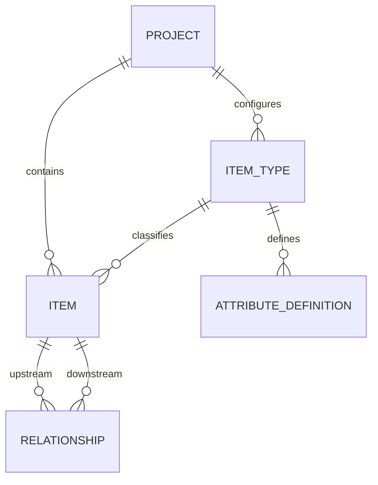

# SSAD 需求管理系统

这是 SSAD 课程作业的需求管理系统简化复现。参考 Jama Connect 的条目化管理思路，把需求和测试用例统一保存为“条目”，再通过关系连接起来。

项目跑通了这条核心流程：

**创建项目 → 配置类型和属性 → 录入需求与测试 → 建立关系 → 修改需求 → 检查并清除复核提示 → 保存和查询。**

作业2.1使用这套系统复现核心链路；作业2.2保留代码生成、缺陷分析、受限制修复和重新设计的过程。本仓库只放代码、设计约定和实验支撑材料。

## 已实现的功能

- 创建、查询项目及条目类型，配置文本、整数、枚举属性。
- 创建、查询、修改、删除条目，按项目、类型或关键词搜索。
- 检查必填属性、值类型、允许取值，以及条目和类型的项目归属。
- 控制状态按规定推进，拒绝非法跳转。
- 建立、删除条目关系，查询上游和下游。
- 上游标题或属性值变化后，标记直接关联的关系需要复核；检查后可以清除标记。
- 用 SQLite 保存数据，重启后仍能查询。

操作入口是 FastAPI 自动生成的 Swagger 页面，没有额外开发网页前端。

## 目录结构

```text
ssad-requirements-management/
├── README.md
├── requirements.txt             # 依赖范围
├── requirements-lock.txt        # 原验证环境使用的精确版本
├── run.ps1                      # Windows 启动脚本
├── v1/                          # 首版：保留缺陷分析对象
├── v2/                          # 按明确约束修复的版本
├── v3/                          # 当前使用的重新设计版
├── tests/                       # 接口、检查程序、编排和适配程序测试
├── tools/
│   ├── demo.py                  # 真实本地 HTTP 演示，包含重启检查
│   ├── gates.py                 # 代码结构检查，可附带接口测试
│   └── deepseek_trial.py        # 两次模型调用的小规模实验
├── agents/                      # 各协作角色的提示文件
├── artifacts/
│   ├── contract.md              # 接口和数据设计约定
│   ├── defects.md               # 首版问题及原因
│   └── constraints.md           # 修复时需要满足的约束
├── orchestrator.py              # 协作流程编排
├── deepseek_client.py           # DeepSeek API 适配程序
└── examples/
    ├── local-verification/      # 2026-10-10 的已有本地验证记录
    └── deepseek-state-check/    # 已完成的真实小模块实验
```

运行后会自动创建 `data/`、`test-work/` 或 `runs/` 等目录，它们已加入忽略规则。已有实验材料放在 `examples/`，不会被这些规则忽略。

## 安装与启动

原验证环境是 Windows / Python 3.12。下面的命令都在仓库根目录执行。

### Windows PowerShell

```powershell
python -m venv .venv
.\.venv\Scripts\python.exe -m pip install -r requirements-lock.txt
.\.venv\Scripts\python.exe -m uvicorn v3.api:app --host 127.0.0.1 --port 8000
```

环境安装好后，也可以执行 `run.ps1` 启动。直接运行上面的 Python 命令不需要调整 PowerShell 脚本执行策略。

### macOS / Linux

```bash
python3 -m venv .venv
.venv/bin/python -m pip install -r requirements-lock.txt
.venv/bin/python -m uvicorn v3.api:app --host 127.0.0.1 --port 8000
```

macOS / Linux 的命令按目录结构提供，本次没有在这两个平台实测。若选择安装 `requirements.txt`，会按照依赖范围解析版本，可能与原验证环境不同。

启动后打开 **http://127.0.0.1:8000/docs**，使用 `Try it out` 填写请求，再点击 `Execute` 执行。按 Ctrl+C 停止服务器。

默认数据库是 `data/v3.db`。首次启动会创建表，后续启动继续使用同一个数据库。本地系统不需要模型API密钥。

## 跑一次完整演示

Windows 下执行：

```powershell
.\.venv\Scripts\python.exe tools/demo.py
```

macOS / Linux 使用 `.venv/bin/python tools/demo.py`。

脚本会自动选择空闲端口，用独立数据库演示：创建需求和测试、拒绝缺失必填字段、拒绝非法状态跳转、建立验证关系、触发和清除复核提示，以及重启后重新查询。

结果写入 `artifacts/demo-verification.json`，数据库放在 `test-work/`。演示不调用模型API，也不会修改默认的 `data/v3.db`。

也可以在 Swagger 中手动操作，按下面的顺序进行：

1. `POST /projects` 创建项目。
2. `POST /item-types` 创建“系统需求”和“测试用例”类型。
3. `POST /item-types/{type_id}/attributes` 配置“验收度量”和“测试步骤”。
4. `POST /items` 分别创建需求和测试条目。
5. `POST /relationships` 建立需求到测试的关系。
6. `PUT /items/{item_id}` 修改需求标题或属性。
7. `GET /items/{item_id}/trace` 查看关系上的复核提示。
8. `POST /relationships/{rel_id}/clear-suspect` 清除提示。

每一步使用接口实际返回的编号。需求的属性值示例：

```json
{
  "验收度量": "响应时间小于3秒"
}
```

这里的“响应时间小于3秒”是需求内容。演示检查需求管理流程，不测量订单系统的真实性能。

## 数据模型与规则

当前代码包含五个核心实体：项目 `Project`、条目类型 `ItemType`、属性定义 `AttributeDefinition`、条目 `Item`、条目关系 `Relationship`。



需求和测试通过类型区分。固定字段保存编号、项目、类型、标题、状态和负责人；配置字段的实际值保存在 `custom_attrs` 中，并按属性定义校验。

状态依次为：`draft → reviewing → approved → implemented → verified`。已知状态允许保持不变，也允许进入 `deprecated`；跳级、回退和未知状态会被拒绝。

关系两端必须在同一项目，不能关联自身，相同起点、终点和关系类型不能重复。复核提示只处理直接下游关系，不自动修改下游内容，也不继续向更远的关系传播。

分析设计中讨论的用户、独立属性值、版本、评审记录和基线属于扩展模型，当前代码尚未实现这些实体。

## 运行测试

Windows：

```powershell
# 当前版本的全部本地测试
.\.venv\Scripts\python.exe -m pytest tests --rms-version v3 --rms-root . -q -p no:cacheprovider

# 修复版的接口测试
.\.venv\Scripts\python.exe -m pytest tests/test_contract.py --rms-version v2 --rms-root . -q -p no:cacheprovider

# 结构检查，并执行接口测试
.\.venv\Scripts\python.exe tools/gates.py v3 --dynamic
```

macOS / Linux 将命令中的 `.\.venv\Scripts\python.exe` 换成 `.venv/bin/python`。

测试里的模型请求使用假客户端或替换后的函数，不产生模型API费用。`v1`用于分析首版问题，正常运行请选择`v3`。

2026-10-11 在整理后的目录中重新验证：v3全部本地测试84项通过，v2接口测试65项通过，两版结构检查各7项通过，真实HTTP演示及重启后数据保留通过。详情见 [本次整理检查](examples/local-verification/20261011-repository-check.json)。

2026-10-10 的已有验证结果：v3全部本地测试81项通过，v2接口测试65项通过，v2与v3结构检查各7项通过。原始记录见 [本地验证记录](examples/local-verification/optimization-verification.json)，其中保留当时电脑上的路径和测试输出；这些路径不参与当前程序运行。

## AI角色协作与真实实验

`agents/` 保留架构、数据、后端、评审和修改角色的提示。`orchestrator.py` 按设计约定交接文件，检查生成格式、Python语法及实际测试结果；新结果写入 `runs/`，不覆盖现有版本。

现有v1、v2、v3由同一AI会话分角色产出并经过本地修复。独立API角色的完整系统生成流程已编写，但没有实际跑完整套流程。

已完成的真实实验是“生成状态检查函数 → 本地测试 → 独立评审”，只覆盖一个小模块：

- Backend、Critic各调用一次，共两次；使用记录中的 `deepseek-flash`，关闭思考模式。
- 六个已知状态加一个未知状态，共49种组合，全部通过。
- 实际用量683 token：输入470，输出213；没有自动重试。
- 评审原文把“6×6”和“49”混写，测试数量以实际测试结果为准。

材料见 [实验摘要](examples/deepseek-state-check/artifacts/summary.json)、[生成代码](examples/deepseek-state-check/generated/state_policy.py) 和 [测试结果](examples/deepseek-state-check/artifacts/test-results.json)。这不是完整系统由独立智能体重新生成的证据。

### 可选：重新执行小规模实验

此步骤会发起真实模型请求。先在本地PowerShell会话配置环境变量，再运行：

```powershell
$env:DEEPSEEK_API_KEY = "在本地填写自己的密钥"
$env:RMS_MODEL = "填写账号当前支持的模型名称"
.\.venv\Scripts\python.exe tools/deepseek_trial.py
```

脚本最多进行生成、评审两次请求，输出上限分别为700和300 token；实际总用量还包括输入。它从环境变量读取配置，不会自动读取 `.env` 文件。

完整协作流程通过 `orchestrator.py --stage all` 启动，需要配置 `RMS_PROVIDER`、`RMS_MODEL` 和对应厂商密钥，会产生更多模型调用。本课程复现和本地测试不需要执行该流程。

## 上传内容

上传这个仓库根目录下的文件和子目录即可。报告、聊天记录、虚拟环境、数据库和真实密钥均未放入整理目录；`.gitignore` 用于排除后续本地运行产生的文件。
